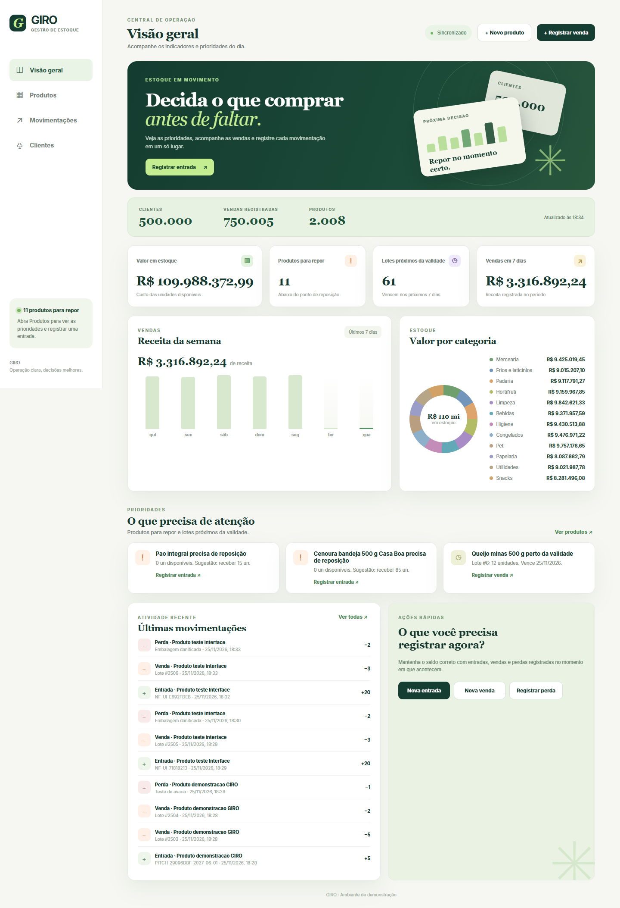
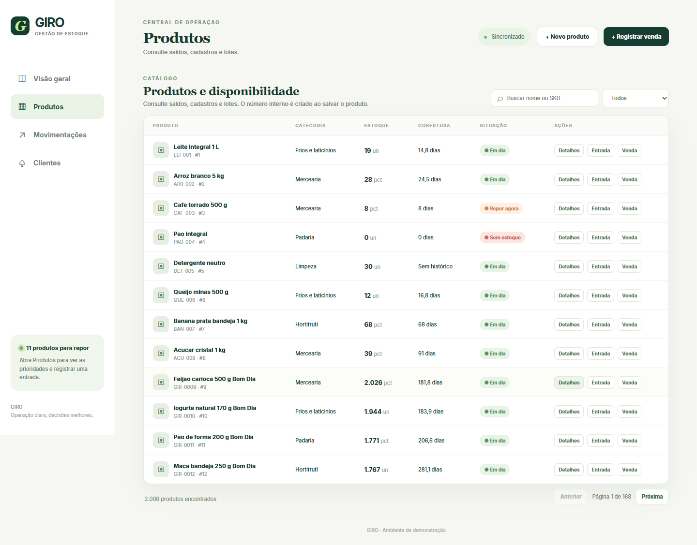
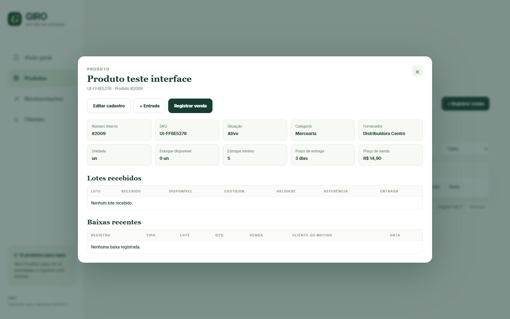
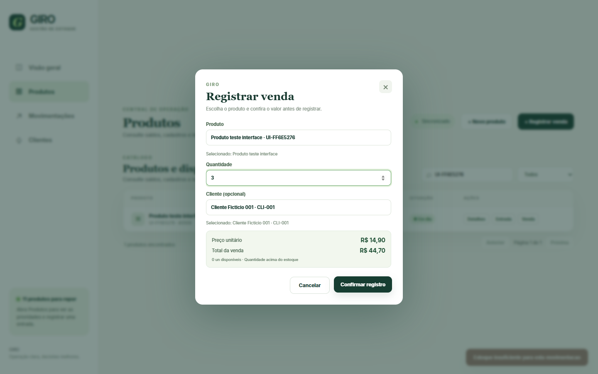
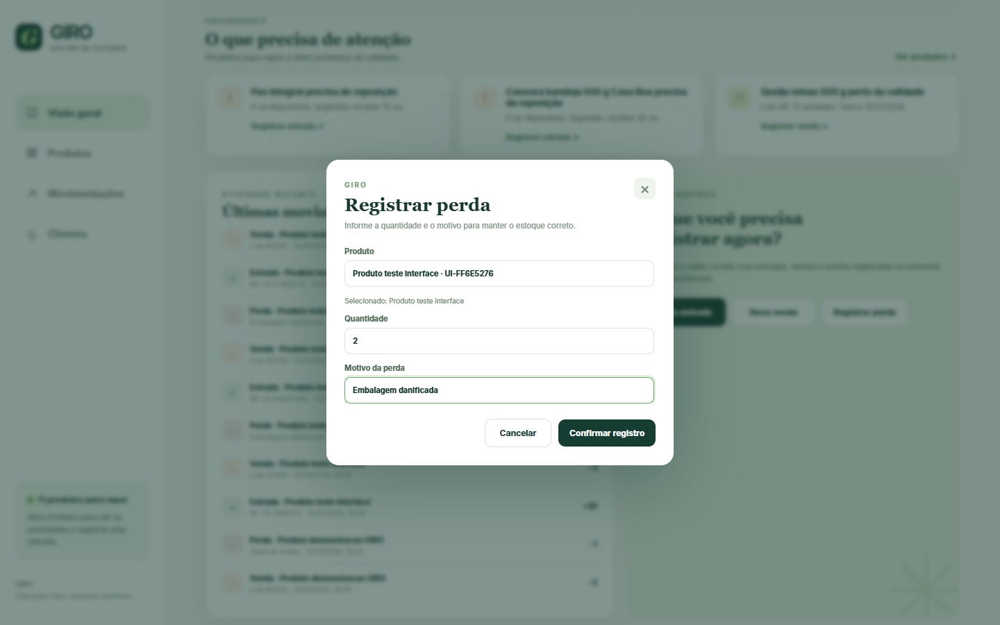
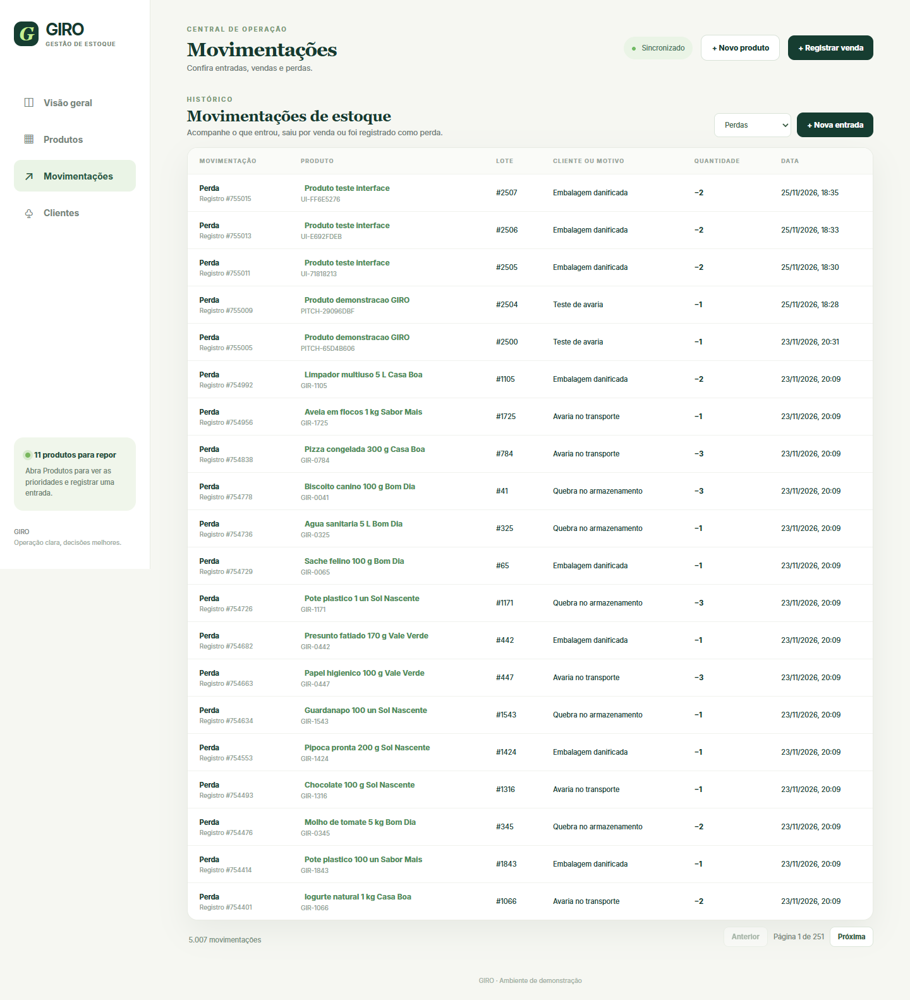
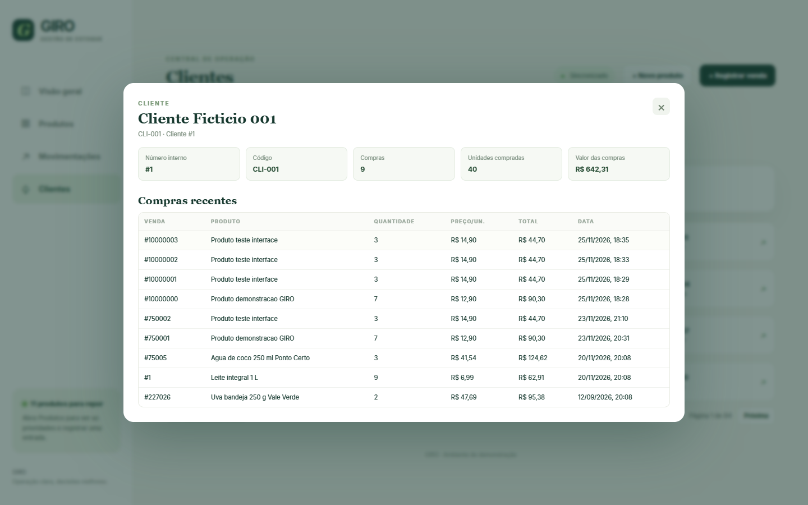

# GIRO — guia de uso e demonstracao

Apresentacao de 25/11/2026. O sistema roda **nesta maquina** em <http://127.0.0.1:3000>. Os dados de clientes sao ficticios. Para iniciar, execute `INICIAR_GIRO.cmd` na raiz do projeto e espere a mensagem `MySQL conectado`. O MySQL Workbench pode ser aberto por `INICIAR_MYSQL_GIRO.cmd`.

## Roteiro curto para mostrar a professora

1. **Visao geral (30 s):** mostre o volume da amostra, os indicadores, os alertas de reposicao e validade e as movimentacoes recentes. Explique que o saldo e calculado a partir dos lotes e das baixas, e nao digitado em uma planilha.
2. **Produtos (45 s):** abra `Produtos`, busque um SKU, avance e volte paginas. Abra `Detalhes` para mostrar categoria, fornecedor, preco, estoque minimo, lote, validade e historico. O numero interno e gerado pelo banco.
3. **Operacao (60 s):** cadastre um produto de teste; registre uma entrada de 20 unidades com custo e referencia; venda 3 unidades a `Cliente Ficticio 000001`; registre perda de 2 unidades. O saldo final deve ser **15**. Abra `Movimentacoes` e filtre entrada, venda e perda.
4. **Banco (45 s):** no Workbench, abra `giro_a3`, a visao `product_balance` e execute `mysql/consultas/07_qualidade.sql` (esperado: nenhuma linha). Mostre o dicionario e uma consulta de negocio. O PDF contem as consultas e resultados.

Use um SKU novo para a demonstracao, por exemplo `DEMO-2511-01`, e uma referencia de entrada nova, por exemplo `NF-DEMO-2511-01`. Se ja tiverem sido usados, acrescente outro numero. O registro fica salvo no MySQL.

## Fluxo 1 — painel e alertas

Abra `Visao geral`. Confira clientes, vendas, produtos, valor de estoque, alertas e atividade recente. Ao clicar em um alerta de reposicao, o formulario de entrada abre com o produto selecionado. Depois de uma operacao, o painel deve refletir o novo saldo.

## Fluxo 2 — lista, busca, filtros e paginacao de produtos

Abra `Produtos`. A lista carrega **12 itens por pagina**. Use `Proxima` e `Anterior`; busque por nome ou SKU; teste os filtros de risco e validade. Clique no nome ou em `Detalhes`. O detalhe mostra cadastro, lotes recebidos e baixas recentes. Em uma lista extensa, a API devolve somente a pagina pedida.

## Fluxo 3 — cadastrar e editar produto

Clique em `+ Novo produto`. Preencha SKU, nome, categoria, fornecedor, unidade, estoque minimo, prazo de entrega, preco e situacao. **Nao existe campo de ID:** o banco o cria e a interface mostra o numero retornado. Abra `Detalhes > Editar cadastro`, altere um campo e salve. Um SKU duplicado e recusado. Produto sem entrada comeca com saldo zero.

## Fluxo 4 — registrar entrada por lote

Clique em `Registrar entrada` ou em `Entrada` na linha do produto. Se necessario, busque o produto e selecione um resultado. Informe quantidade, custo unitario, validade opcional e nota/referencia opcional. Confirme. O lote novo aumenta o saldo disponivel; a referencia repetida e bloqueada para evitar entrada dupla. Confira em `Detalhes` e `Movimentacoes > Entradas`.

## Fluxo 5 — registrar venda e verificar recusa

Clique em `+ Registrar venda` ou em `Venda` na linha do produto. Selecione o produto, informe quantidade e, se quiser, busque o cliente por nome/codigo e **clique no resultado**. O valor total aparece antes de confirmar. Uma quantidade acima do saldo gera erro de estoque insuficiente e nao altera a base. Com quantidade valida, a venda e as baixas dos lotes sao gravadas juntas em uma transacao. O sistema consome primeiro o lote com vencimento mais proximo (FEFO). Confira em `Movimentacoes > Vendas`, no produto e no historico do cliente.

## Fluxo 6 — registrar perda

Em `Visao geral`, clique `Registrar perda`. Busque e selecione o produto; informe quantidade e **motivo**. Confirme. A perda reduz o saldo e aparece em `Movimentacoes > Perdas`; sem motivo, o registro e recusado. Uma perda superior ao saldo tambem e recusada.

## Fluxo 7 — clientes

Abra `Clientes`, busque `CLI-001`, avance/volte paginas e abra o detalhe. A tela mostra o cadastro ficticio e o historico de compras. Se a venda de demonstracao foi associada ao cliente, ela aparecera aqui.

## Fluxo 8 — tela menor e API

O menu, os indicadores e as acoes tambem aparecem em largura de celular. Na API, `GET /api/products`, `/api/customers` e `/api/movements` aceitam `page`; a resposta inclui `items`, `total`, `page` e `pages`. O MySQL e a fonte permanente. O Redis acelera leituras do painel e catalogo quando esta disponivel; se cair, um cache em memoria continua acelerando consultas, sempre reconstruido a partir do MySQL.

## Se algo falhar durante a apresentacao

- Atualize o navegador uma vez e confira `http://127.0.0.1:3000/api/health` (`ok: true`, `database: MySQL`).
- Execute `INICIAR_GIRO.cmd` novamente se o servidor parou. O Redis e opcional; `cache: memory` indica o cache local de contingencia.
- Para o banco, use a conexao local `GIRO A3 - MySQL local` no Workbench. A consulta de qualidade e o relatorio em PDF permitem continuar a defesa mesmo sem a interface.
- Nao mostre `mysql/runtime/` nem `mysql/CONEXAO_LOCAL.txt` em publico: contem credenciais locais.
